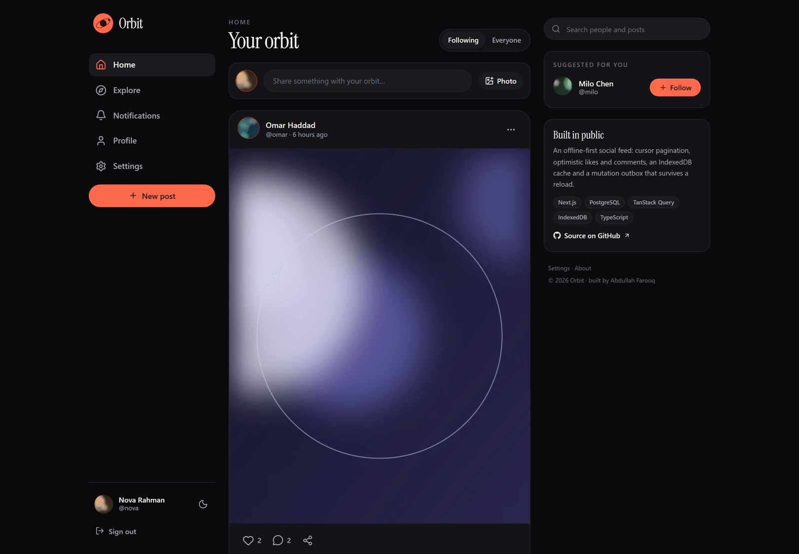
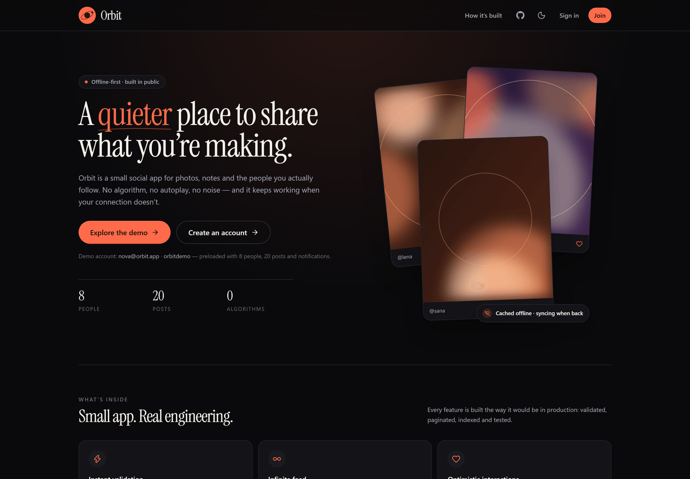
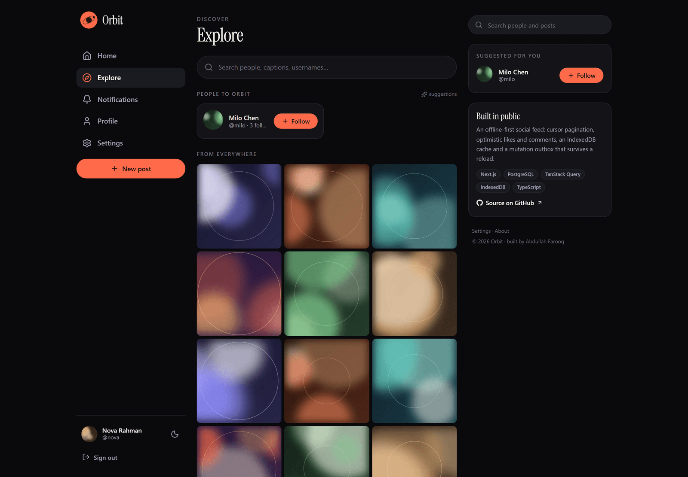
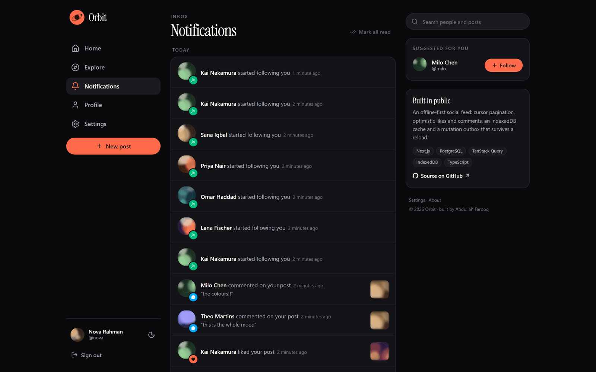
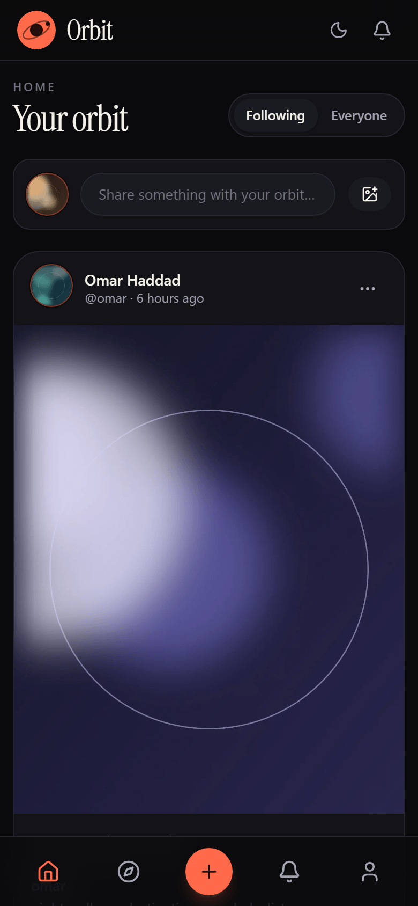

# Orbit

**A small, offline-first social app — built like it has users.**

An Instagram-shaped application with a cursor-paginated feed, optimistic likes and comments, real image uploads, follow graph, notifications, and an IndexedDB cache that keeps the feed readable after a cold reload with no connection.

[](https://github.com/abdullahf97/orbit-social/actions/workflows/ci.yml)
[](LICENSE)
[](https://nextjs.org)
[](https://www.typescriptlang.org)



## Try it

The demo account is seeded with 8 people, 20 posts, a follow graph and a full notification inbox.

| Email | Password |
| --- | --- |
| `nova@orbit.app` | `orbitdemo` |

> Every seeded user shares the same password. Sign in as `kai@orbit.app`, `lena@orbit.app`, etc. to see the other side of a like or follow.

## What is implemented

| Requirement | How it works |
| --- | --- |
| **Instant login validation** | Debounced username availability, inline field errors, password strength meter, and a Zod schema shared by the form and the API. No request is sent for an invalid field. |
| **Authentication** | Opaque 256-bit session tokens in `httpOnly` cookies. Only the SHA-256 hash is stored, so sessions are revocable and a database leak cannot be replayed. |
| **Infinite feed** | Keyset pagination on `(createdAt DESC, id DESC)` with an `IntersectionObserver` sentinel. New posts while scrolling cannot duplicate or skip rows. |
| **Optimistic likes & comments** | Mutations patch every cached copy of a post (feed, profile grid, search, detail) and roll back to a snapshot on failure. |
| **Image uploads & previews** | Local preview before upload, browser-side downscale for large files, `sharp` re-encode to WebP on the server, EXIF stripped. Local disk in dev, Vercel Blob in production. |
| **Follow / unfollow** | Idempotent writes backed by a unique constraint, with optimistic follower counts and suggestion-list removal. |
| **Notifications & unread counters** | Written inside the same transaction as the action that causes them (never for yourself). Badge polls every 20s, list every 30s; per-item and mark-all-read are optimistic. |
| **Offline feed cache** | TanStack Query is persisted to IndexedDB. A service worker caches the app shell, pages and images. Queued mutations replay on reconnect. |
| **Comments & replies** | Cursor-paginated threads, one-level replies, delete-own (plus replies), comment counts kept consistent. |
| **Search & explore** | People + caption search, suggestion list, infinite explore grid. |

<table>
  <tr>
    <td></td>
    <td></td>
  </tr>
  <tr>
    <td></td>
    <td></td>
  </tr>
</table>

## Stack

- **Framework** — Next.js 16 App Router, React 19, TypeScript strict
- **Data** — PostgreSQL 17, Prisma 7 (driver adapter), keyset pagination
- **Client state** — TanStack Query 5, IndexedDB (`idb`), persisted mutation cache
- **Styling** — Tailwind CSS v4, custom design tokens, dark-first with a light theme
- **Media** — `sharp` for WebP resizing, Vercel Blob in production
- **Testing** — Vitest (46 unit tests), Playwright (16 E2E tests), API smoke script, GitHub Actions

## Engineering notes

A few decisions that shaped the codebase. The longer version lives in [docs/ARCHITECTURE.md](docs/ARCHITECTURE.md).

**Keyset pagination, not `OFFSET`.** Every feed page is filtered by the last row's `(createdAt, id)` pair and ordered by the same tuple. It stays stable while people post, and the composite index does the work instead of the database counting skipped rows.

**Denormalised counters.** `likeCount`, `commentCount`, `followerCount` and `postCount` are updated in the same transaction as the write that changes them. Feeds never run `COUNT(*)`, and the UI can trust a single row.

**Idempotent writes for the offline outbox.** Likes and follows use unique constraints plus `skipDuplicates`. Comments and posts accept client-generated ids, so replaying a queued action after a reload returns the existing row instead of creating a duplicate.

**Offline is a real state, not a banner.** Queries use `offlineFirst` and mutations use `online` network mode. Actions taken offline pause in the persisted mutation cache and resume on the `online` event. The service worker caches the shell and pages; TanStack owns the data.

**Opaque sessions over JWTs.** A random 256-bit token is set as an `httpOnly`, `SameSite=Lax` cookie. Revocation is a delete, there is no refresh-token dance, and no signing secret leaks into the client.

**Uploads are validated twice.** The browser downscales files over ~1.2 MB with a canvas; the server decodes with `sharp` (which rejects non-images), strips EXIF, corrects orientation, and emits a 1600px WebP plus a 480px thumbnail. Only URLs the server produced can be attached to a post.

## Run it locally

**Prerequisites:** Node.js 22+, Docker (or any PostgreSQL 17 instance).

```bash
git clone https://github.com/abdullahf97/orbit-social.git
cd orbit-social

npm install
cp .env.example .env

npm run db:up        # postgres:17-alpine on :5432
npm run db:migrate   # apply the schema
npm run db:seed      # 8 users, 20 posts, likes, follows, notifications

npm run dev          # http://localhost:3000
```

Open <http://localhost:3000> and use the demo button, or sign in with `nova@orbit.app` / `orbitdemo`.

### Environment

| Variable | Required | Notes |
| --- | --- | --- |
| `DATABASE_URL` | yes | PostgreSQL connection string |
| `NEXT_PUBLIC_APP_URL` | no | Used for origin checks and absolute URLs. Defaults to `http://localhost:3000`. |
| `STORAGE_DRIVER` | no | `local` (default) writes to `public/uploads`; `vercel-blob` needs a token. |
| `BLOB_READ_WRITE_TOKEN` | prod | Required when `STORAGE_DRIVER=vercel-blob`. |
| `SEED_PASSWORD` | no | Demo password, defaults to `orbitdemo`. |

## Scripts

| Command | What it does |
| --- | --- |
| `npm run dev` | Development server |
| `npm run build` | `prisma generate` + production build |
| `npm start` | Serve the production build |
| `npm run typecheck` | `tsc --noEmit` |
| `npm run lint` | ESLint |
| `npm test` | Vitest unit suite |
| `npm run test:e2e` | Playwright against a production build (needs a seeded DB) |
| `npm run smoke` | API smoke test against a running server |
| `npm run screenshots` | Regenerate the images in `docs/screenshots` |
| `npm run db:migrate` / `db:seed` / `db:reset` / `db:studio` | Prisma helpers |

## Testing

**Unit (Vitest).** Cursor encode/decode and tamper resistance, password hashing/verification, Zod schemas, formatting helpers. 46 tests, no database required.

**End-to-end (Playwright).** Runs against `next start` so the service worker is active. Covers:

- form validation before a request is sent, wrong password, demo login, username availability
- infinite scroll loading a second page
- a like that flips the UI *before* the delayed response arrives
- adding and deleting a comment
- follow → reload → unfollow
- an unread badge that clears with mark-all-read
- a cold offline reload rendering the cached feed
- an offline like queued and replayed on reconnect
- composer image preview, post creation and deletion, profile validation

**CI.** GitHub Actions runs typecheck, lint, unit tests and a production build, then a second job with a PostgreSQL service runs migrations, seeds the database and executes the Playwright suite.

## Deploying

1. Push the repository to GitHub and import it into Vercel.
2. Create a Neon (or any) PostgreSQL database and set `DATABASE_URL`.
3. Add a Vercel Blob store and set `BLOB_READ_WRITE_TOKEN`, `STORAGE_DRIVER=vercel-blob`.
4. Set `NEXT_PUBLIC_APP_URL` to the deployment origin.
5. Run `npx prisma migrate deploy` (and optionally `npm run db:seed`) against the production database.

Serverless filesystems are read-only, so the local disk adapter is intentionally development-only.

## Known limits

These are deliberate trade-offs for a portfolio-sized app, documented rather than hidden:

- **Rate limits are per instance.** In-memory fixed windows reset on cold starts and are not shared between Vercel functions. Production traffic should swap in Upstash Redis behind the same interface.
- **Notifications poll.** A WebSocket or SSE layer needs a stateful host or managed pub/sub; a 20-second poll keeps the badge honest without that infrastructure.
- **Single-region database.** Keeps latency predictable; multi-region reads are out of scope.
- **No email verification or password reset.** The demo is seed-based on purpose.

## Project layout

```
src/
  app/            routes, API handlers, metadata
    (app)/        authenticated shell: feed, explore, profile, post, notifications, settings
    (auth)/       login and signup
    api/          route handlers (auth, feed, posts, comments, follows, uploads, search)
  components/     app shell, offline banner, UI primitives
  features/       api hooks + cache, auth session, feed, posts, users
  lib/            isomorphic helpers: cursor, schemas, image, utils
  server/         db, auth, storage, rate limiting, serializers
prisma/           schema, migration, deterministic seed
e2e/              Playwright specs + one-time auth setup
docs/             architecture notes and screenshots
```

## License

[MIT](LICENSE) © 2026 Abdullah Farooq
